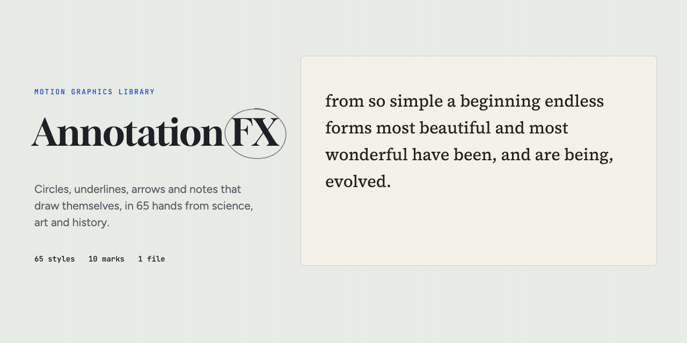

# Annotation FX

[](https://hntw.github.io/annotation-fx/)

Circles, underlines, arrows and margin notes that draw themselves, in the hands of 65 people from science, art and
history. Lyell lays highlights down as rock strata. Darwin's arrows branch into a tree. Anning's rings end in an
ammonite. Basquiat crowns what matters. Dalí's circles melt.
Point it at a word, a face in a photo or an object in running video, and render transparent overlays for video editors.
One file, no dependencies, MIT.

**Live demo:** https://hntw.github.io/annotation-fx/

**New in v2:** every style is rebuilt from a real page in that person's hand. See [how we did it, and the breaking changes](NOTES-v2.md).

## Marks

`circle`, `box`, `underline`, `strike`, `cross`, `highlight`, `bracket`, `arrow`, `note`, `connect`.
Any mark takes a `note`, written beside it with a leader line on the side with the most room.

## Styles

| field | styles |
|---|---|
| Science | lyell, darwin, davinci, hooke, newton, galileo, cajal, feynman, nightingale, edison, leavitt, anning, lovelace, hopper, curie, merian, franklin, ramanujan, banneker, carver, raman, seacole |
| Art | picasso, dali, vangogh, matisse, mondrian, kandinsky, hokusai, warhol, haring, afklint, kusama, kahlo, basquiat, ringgold, lawrence, ross, dickinson, beethoven, tagore, hurston, okeeffe, klee |
| History | scriptorium, champollion, bayeux, mercator, minard, bletchley, kranz, perkins (default), aljazari, qianlong, maya, lincoln, churchill, napoleon, jefferson, douglass, gandhi, elizabeth, mandela, bell, pizan |

Each style is built from a real page in that person's hand (a letter, notebook, manuscript or signature) and
`source` says which one and where it is held. They are homages to those habits, not reproductions of the work.
`AnnotationFX.styles` lists each with its name, year, a one-line description of the style and `bio`, a short profile of
the person (or the people) behind it. The demo shows each profile under its card.

## Use it

```html
<script src="annotationfx.js"></script>
<p id="quote">from so <span id="w1">simple</span> a beginning ... <span id="w3">evolved.</span></p>
<script>
  AnnotationFX.play('#quote', {
    style: 'darwin', bleed: 40,
    marks: [
      { mark: 'circle', box: '#w1' },
      { mark: 'arrow',  box: '#w3', note: 'I think' }
    ]
  });
</script>
```

On an image or video, boxes are in the media's own pixels (`[x, y, w, h]`) and respect object-fit. For video, give
keyframes `[{ t, x, y, w, h }, ...]`: the mark reads the video's clock. `AnnotationFX.draw(ctx, t, w, h, opts)` is a
pure function of time for rendering video frames. No code: `data-annotate='{"style":"dali","box":"#w1"}'` plus
`<script src="annotationfx.js" data-auto>`.

## Speed and timing

`speed` sets how fast the hand draws: a number (2 is twice as fast) or `slow`, `calm`, `normal`, `brisk`, `fast`, `snap`.
Set it once or per mark. It never moves an explicit `delay`.

Marks can wait for a cue:

```js
// fire each mark as its words scroll into view (repeat: clear on leave, draw again on return)
AnnotationFX.play(article, { style: 'darwin', when: 'each', repeat: true,
  marks: [{ mark: 'circle', box: '#bank' }, { mark: 'box', box: '#selection' }] });

// or fire them yourself when your text lands (a typed line, a caption, a slide)
var fx = AnnotationFX.play(line, { delay: 'wait', marks: [
  { id: 'simple', mark: 'circle', box: '#simple' }, { id: 'evolved', mark: 'arrow', box: '#evolved', note: 'I think' }] });
fx.fire('simple');            // or fx.fire() for the next waiting mark, fx.fire('*') for all

// on video: delays in video seconds, following pause, seek and loop
AnnotationFX.play(video, { sync: 'media', marks: [{ mark: 'circle', box: [...], delay: 3.2 }] });
```

`when`: `visible` (default; tune with `threshold` and `rootMargin`), `now`, `manual`, `each`. Hooks: `onStart`,
`onMark`, `onDone`, also fired as bubbling DOM events `annotationfx:start|mark|done`. The handle from `play()` has
`start`, `stop`, `replay`, `pause`, `resume`, `fire`, `reset`, `seek(t)` and `time()`; `AnnotationFX.fire(el, which)` works
from anywhere.

Canvas text needs the web fonts loaded before the first frame. `AnnotationFX.loadFonts(ids)` adds the Google Fonts
for the styles you name (or all of them) and resolves when they are ready: `AnnotationFX.loadFonts(['darwin']).then(go)`.

## Render overlays for video

```sh
zsh tools/serve.sh 8793 &
node tools/render.mjs examples/rock-notes.json out/rock-notes --bg media/demo/rock-72255-wide.jpg
```

The spec is AnnotationFX options with boxes in the media's pixels plus `"media": {"w", "h"}`. You get `name.mov`
(ProRes 4444 with alpha), `name.webm` (VP9 with alpha) and, with `--bg`, `name_preview.mp4`. Flags: `--w`, `--h`,
`--fps`, `--dur` (default: the marks' length plus a second). Needs ffmpeg and Playwright (`npm i`).

## Develop

```sh
zsh tools/serve.sh 8793        # no-cache server
node test/smoke.js             # every style x mark x size across the timeline, counts throws and NaN
node test/page.mjs             # screenshots of the demo page (desktop, phone, dark) into out/
node test/timing.mjs           # the scroll-in and type-in cue demos, logs every annotationfx:mark event
node media/anim.mjs            # the header loop (gif; add mp4 or still)
```

Text on the demo: Charles Darwin, On the Origin of Species (1859), public domain. Photo: NASA JSC S73-16007, Apollo 17
sample 72255, public domain.
